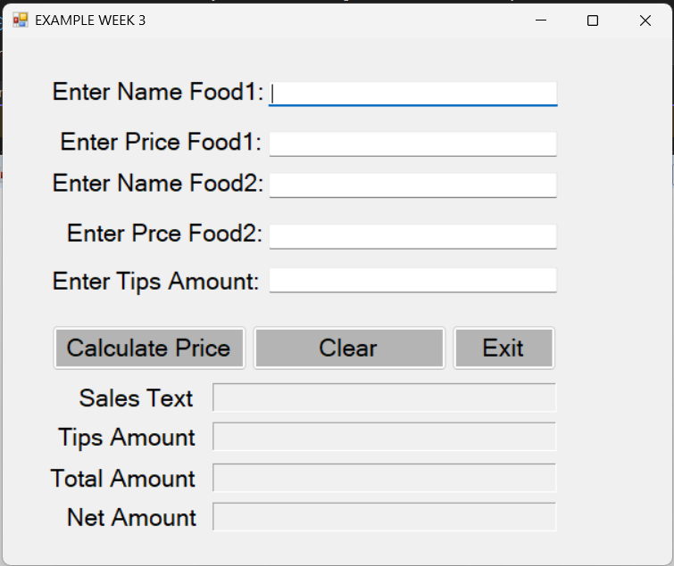

# EXAMPLE WEEK 3 [Food Bill Calculator]



> ### Sida aad arki karto sawirkaan waxaan sameeyay form yar oo xisaabiya biilka cuntada. Waxaan ku practice gareeyay
> 1. **Textbox Control**
> 2. **Label Control**
> 3. **Button Control**
> 4. **Variables, Constants iyo Data Conversion**
> 5. **Try-Catch**

# Qeybta 1aad [Textbox Control]

Waxaa sameestay shan **Textbox** oo user-ka ka qaadaya xogta. Mid walba waxaa hor yaal Label u sheegaya waxa la geliyo:

- **Enter Name Food1** (`TxtFood1`): magaca cuntada koowaad
- **Enter Price Food1** (`TxtPriceFood1`): qiimaha cuntada koowaad
- **Enter Name Food2** (`TxtFood2`): magaca cuntada labaad
- **Enter Price Food2** (`TxtPriceFood2`): qiimaha cuntada labaad
- **Enter Tips Amount** (`TxtTIpsAmount`): tips-ka, oo aan u isticmaalay **boqolkiiba**. Haddii user-ku geliyo `10`, waa 10%.

# Qeybta 2aad [Label Control]

Hoosta waxaa yaal afar **Label** oo natiijada tusaya. Marka form-ka furmo way madhan yihiin, waxaana lagu shubaa marka **Calculate Price** la riixo.

- **Sales Text** (`LblSalesText`): canshuurta iibka, oo ah 5%
- **Tips Amount** (`LblTipsAmount`): lacagta tips-ka ah
- **Total Amount** (`LblTotalAmount`): wadarta guud ee la bixinayo
- **Net Amount** (`LblNetAmount`): qiimaha cuntada oo keliya, canshuur iyo tips la'aan

# Qeybta 3aad [Button Control]

Waxaa sameestay saddex **Button**, mid walbana shaqo gaar ah ayuu leeyahay.

-- ***Button-ka Koowaad [Calculate Price]***

Button-kaan wuxuu qaadaa xogta textbox-yada, xisaabiyaa, kadibna natiijada ku shubaa labels-ka. Waana kan Syntax aan qoray:

```
private void Btn_Amount_Click(object sender, EventArgs e)
{
    // creating variables
    String Food1, Food2;
    Double P_Food1, P_Food2, Amount, TotalAmount, SalesTax, Tips, NetAmount;

    // creating const variables
    const double SALES_TAX_RATE = 5;

    // Taking the tips rate from The User
    double tipsRate = int.Parse(TxtTIpsAmount.Text);

    try
    {
        // Taking the data from the User
        // Also Making convertions
        Food1 = TxtFood1.Text;
        Food2 = TxtFood2.Text;
        P_Food1 = double.Parse(TxtPriceFood1.Text);
        P_Food2 = double.Parse(TxtPriceFood2.Text);

        // process

        // calculating total amount
        Amount = P_Food1 + P_Food2;

        // calculating the tax amount
        SalesTax = Amount * (SALES_TAX_RATE / 100);
        Tips = Amount * (tipsRate / 100);

        // calculating Total Amount for pay
        TotalAmount = Amount + SalesTax + Tips;

        // Calculating the net Amount
        NetAmount = TotalAmount - SalesTax - Tips;

        // Displaying The Amounts
        // Also Making Convertions B/W string to
        LblSalesText.Text = SalesTax.ToString("c");
        LblTipsAmount.Text = Tips.ToString("c");
        LblTotalAmount.Text = TotalAmount.ToString("c");
        LblNetAmount.Text = NetAmount.ToString("c");
    }

    catch (Exception)
    {
        MessageBox.Show("Enter Valid Values");
    }
}
```

Sidaan u xisaabiyay:

| Waxa la xisaabinayo | Formula |
|---|---|
| Amount | Price Food1 + Price Food2 |
| Sales Tax | Amount x 5 / 100 |
| Tips | Amount x tipsRate / 100 |
| Total Amount | Amount + Sales Tax + Tips |
| Net Amount | Total Amount - Sales Tax - Tips |

Tusaale: haddii Food1 yahay `10`, Food2 yahay `15`, tips-kuna yahay `10`, markaas Amount waa `25`, Sales Tax waa `1.25`, Tips waa `2.50`, Total waa `28.75`, Net-kuna waa `25`.

> **THE RESULT**


Halkan waxaan ku practice-gareeyay:

- **Variables**: declaring iyo initializing, oo ay ku jiraan `String` iyo `Double`
- **const**: `SALES_TAX_RATE` waa constant, sidaa darteed qiimihiisa lama beddeli karo
- **Data conversion**: `double.Parse()` iyo `int.Parse()` waxay textbox-ka (string) u beddelaan number. `ToString("c")` wuxuu number-ka ka dhigaa lacag (currency) si label-ka loogu soo bandhigo.
- **Try-Catch**: haddii user-ku geliyo wax aan number ahayn, program-ku ma burburo, wuxuu soo bandhigaa MessageBox oo leh "Enter Valid Values".

-- ***Button-ka Labaad [Clear]***

Button-kaan wuxuu nadiifiyaa dhammaan textboxes-ka iyo labels-ka si user-ku mar kale u bilaabo. Waxaan isticmaalay saddexda hab ee la nadiifin karo: `Clear()`, `""`, iyo `String.Empty`. Waana kan Syntax aan qoray:

```
private void BtnClear_Click(object sender, EventArgs e)
{
    // clearing the text boxes
    TxtFood1.Clear();
    TxtFood2.Text = "";
    TxtPriceFood1.Text = String.Empty;
    TxtPriceFood2.Clear();
    TxtTIpsAmount.Clear();

    // clearing the labels
    LblSalesText.Text = String.Empty;
    LblTipsAmount.Text = String.Empty;
    LblTotalAmount.Text = String.Empty;
    LblNetAmount.Text = String.Empty;
}
```

> **THE RESULT**


-- ***Button-ka Saddexaad [Exit]***

Button-kaan wuxuu xeraa form-ka. Waxaan isticmaalay `this.Close()`. Waana kan Syntax aan qoray:

```
private void BtnExit_Click(object sender, EventArgs e)
{
    // Closing the form
    this.Close();
}
```

---

# Xusuus

- **Net Amount** wuxuu noqonayaa isla `Amount`, maxaa yeelay waxaan ka jaray Sales Tax iyo Tips wixii aan Total-ka ku daray. Waxaan u isticmaalay practice si aan u arko sida xisaabtu u shaqayso.
- **Tips** waa boqolkiiba, ma aha lacag toos ah, in kasta oo label-ku yidhaahdo "Tips Amount".