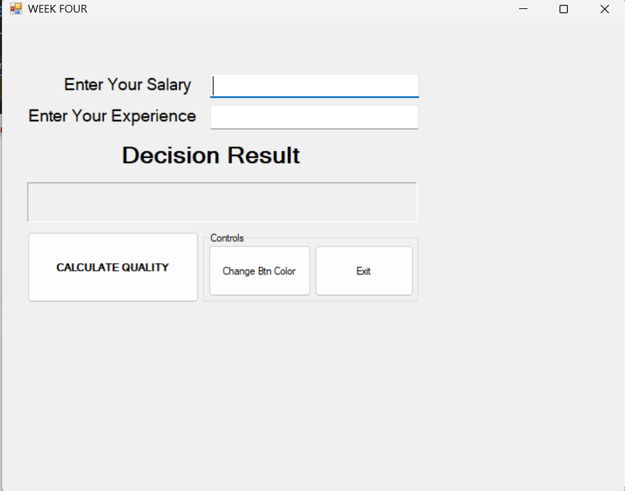
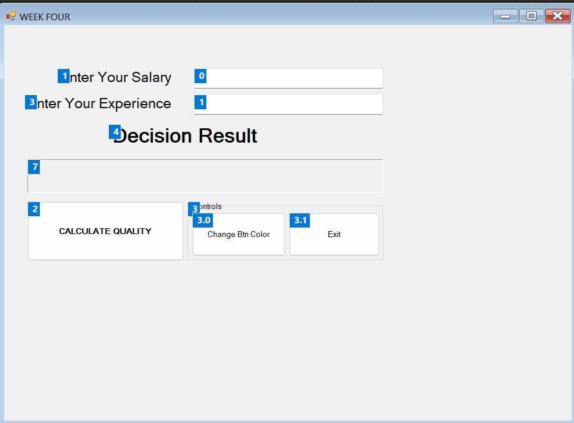
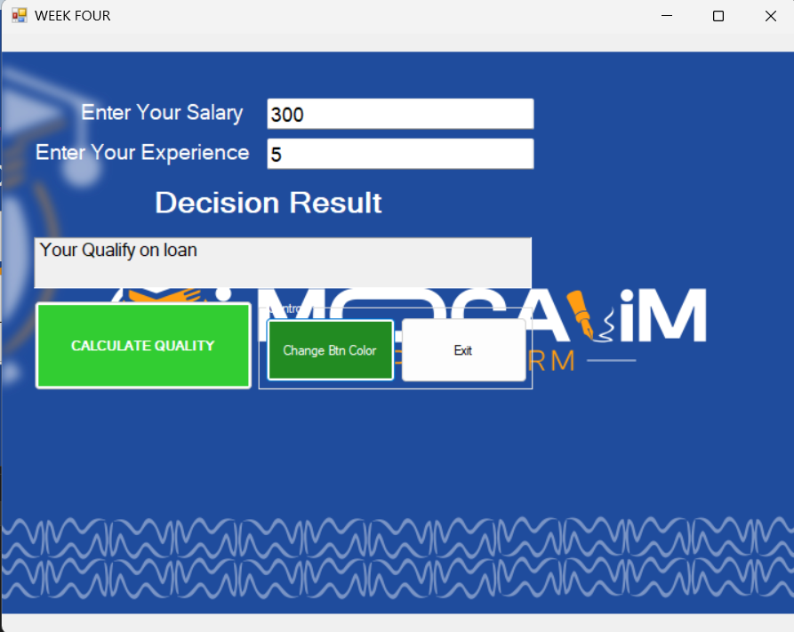
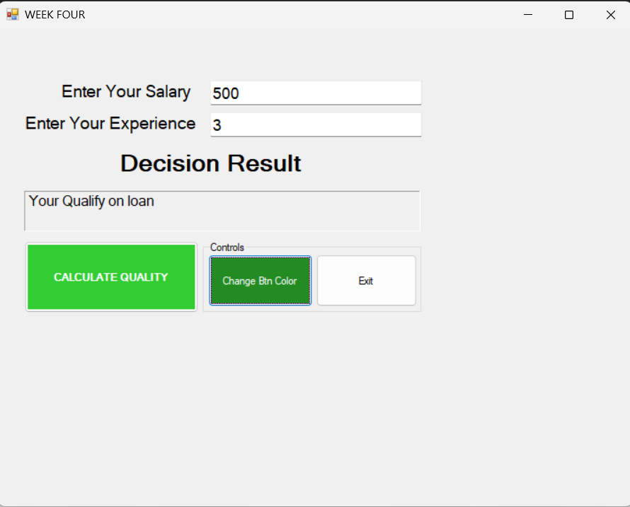

# WEEK FOUR [Loan Qualification Checker]



> ### Sida aad arki karto sawirkaan waxaan sameeyay form yar oo hubiya haddii qofka u qalmo **loan**. Waxaan ku practice gareeyay
> 1. **Textbox iyo Label Control**
> 2. **Decision Making (if / else)**
> 3. **Data Validation (TryParse)**
> 4. **GroupBox Control**
> 5. **Button Colors (BackColor iyo ForeColor)**

# Qeybta 1aad [Controls-ka Form-ka]

Form-ku wuxuu leeyahay laba **Textbox** oo user-ka ka qaadaya xogta:

- **Enter Your Salary** (`TxtSalary`): mushaharka user-ka
- **Enter Your Experience** (`TxtYearsExp`): sannadaha khibradda

Hoostooda waxaa yaal **Decision Result** Label, iyo `lblDesicion` oo ah label dheer oo jawaabta tusaya.

Waxaa kale oo jira saddex **Button**:

- **CALCULATE QUALITY** (`BtnCheckQuali`): hubiya haddii user-ku u qalmo loan
- **Change Btn Color** (`BtnChangeClr`): beddela midabka buttons-ka
- **Exit** (`BtnExit`): xeraa form-ka

Labada button ee u dambeeya waxaan geliyay **GroupBox** oo magaciisu yahay *Controls*, si ay isugu ururaan.

-- ***Tab Order***

Sawirka hoose wuxuu muujinayaa **TabIndex** ee control kasta, waxaanan ku habeeyay in marka user-ku riixo `Tab` uu ka bilaabo Salary textbox-ka, kadibna u gudbo Experience textbox-ka.



-- ***Background Image***

Form-ka waxaan ku tijaabiyay **BackgroundImage**. Labels-ka midabkooda waxaan ka dhigay caddaan si loo arki karo, sida sawirka hoose.



# Qeybta 2aad [Button-ka Calculate Quality]

Button-kaan wuxuu hubiyaa xogta user-ka, kadibna go'aan gaaraa. Waana kan Syntax aan qoray:

```
private void BtnCheckQuali_Click(object sender, EventArgs e)
{
    // Variables
    double salary, yearsExperience, validation;

    // constant variable
    const double YEARS_EXP = 2;

    // preventing Data Concvertion try parse
    // syntax - two argument one keyword out
    // double.tryparse(String, out target var)
    // target variable
    if (double.TryParse(TxtSalary.Text, out validation) & double.TryParse(TxtYearsExp.Text, out yearsExperience))
    {
        try
        {
            // Assigning variables - user input to store variables
            salary = double.Parse(TxtSalary.Text);
            yearsExperience = double.Parse(TxtYearsExp.Text);

            // validation
            if (salary > 0 & yearsExperience > 0)
            {
                // check the load condition
                // checking salary
                if (salary >= 200) // true
                {
                    // checking years of experience
                    if (yearsExperience >= YEARS_EXP)
                    {
                        lblDesicion.Text = "Your Qualify on loan";
                    }
                    else
                    {
                        lblDesicion.Text = "You Experience must be Greater than 2 years";
                    }
                }
                else
                {
                    lblDesicion.Text = "You Salary is less than 200 ";
                }
            }
            else
            {
                lblDesicion.Text = "Salary and years of exprience must be Positive";
            }
        }
        catch (Exception ex)
        {
            MessageBox.Show(ex.Message);
        }
    }

    else
    {
        lblDesicion.Text = "Salary and Years of Experience Must be Integer";
    }
}
```

Sida shaqadu u socoto:

1. **TryParse** ayaa marka hore hubiya in labada textbox ay yihiin number. Haddii kale, label-ku wuxuu tusaa fariin cillad ah.
2. Haddii ay number yihiin, waxaan hubiyaa in labadooda ay ka weyn yihiin `0`.
3. Kadib waxaan hubiyaa **salary**, waa inuu ahaado `200` ama ka badan.
4. Ugu dambayn waxaan hubiyaa **experience**, waa inuu ahaado `2` sano ama ka badan (`YEARS_EXP` waa constant).
5. Haddii labadaba ay buuxsamaan, label-ku wuxuu tusaa **"Your Qualify on loan"**.

| Salary | Experience | Natiijada |
|---|---|---|
| 500 | 3 | Your Qualify on loan |
| 300 | 5 | Your Qualify on loan |
| 150 | 5 | You Salary is less than 200 |
| 500 | 1 | You Experience must be Greater than 2 years |
| -5 | 3 | Salary and years of exprience must be Positive |
| abc | 3 | Salary and Years of Experience Must be Integer |

> **THE RESULT**



# Qeybta 3aad [Button-ka Change Btn Color]

Button-kaan wuxuu beddelaa midabka iyo farta buttons-ka isagoo isticmaalaya **BackColor** iyo **ForeColor**. Waana kan Syntax aan qoray:

```
private void BtnChangeClr_Click(object sender, EventArgs e)
{
    // changing the buttons color and their fonts
    BtnCheckQuali.BackColor = Color.LimeGreen;
    BtnCheckQuali.ForeColor = Color.White;

    // changing the buttons color and their fonts
    BtnChangeClr.BackColor = Color.ForestGreen;
    BtnChangeClr.ForeColor = Color.White;
}
```

`BackColor` wuxuu beddelaa midabka button-ka gudihiisa, `ForeColor`-na wuxuu beddelaa midabka qoraalka. Sawirka koowaad iyo kan sare ee natiijada waxaad ku arki kartaa **CALCULATE QUALITY** oo noqday *LimeGreen*, **Change Btn Color**-na wuxuu noqday *ForestGreen*.

# Qeybta 4aad [Label-ka Natiijada iyo Exit]

Marka `lblDesicion` la riixo, qoraalkiisa waa la tirtiraa. Button-ka **Exit**-na wuxuu xeraa form-ka. Waana kan Syntax aan qoray:

```
private void lblDesicion_Click(object sender, EventArgs e)
{
    // clear label text
    lblDesicion.Text = String.Empty;
}

private void BtnExit_Click(object sender, EventArgs e)
{
    // Exit the Application
    this.Close();
}
```

> THE RESULT


