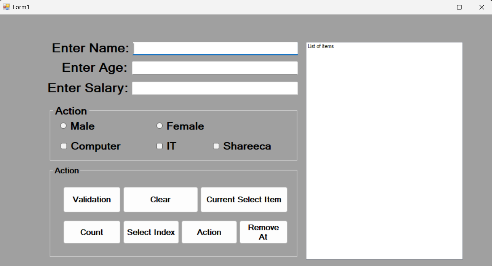
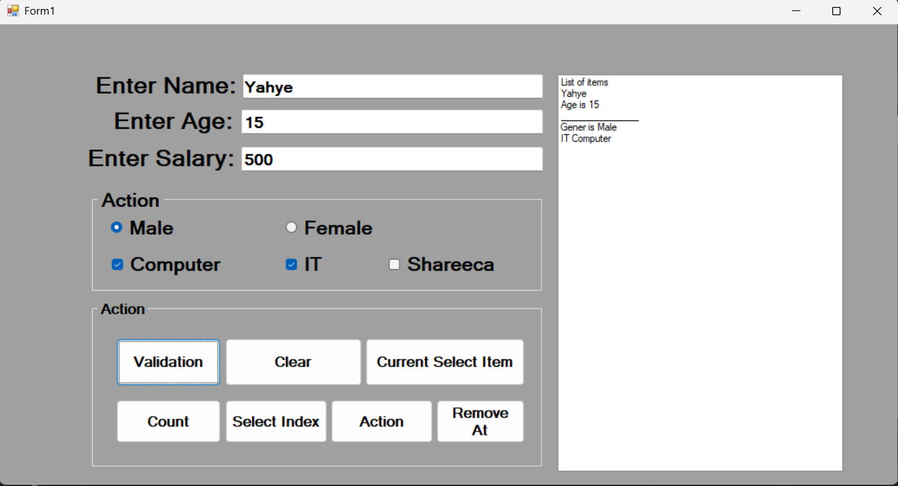

# WEEK FIVE [ListBox iyo GroupBox Practice]



> ### Sida aad arki karto sawirkaan waxaan sameeyay form yar oo xogta user-ka geliyo **ListBox**. Wax kasta oo aan ku practice gareeyay waa **code-ka**, ma ahan controls-ka. Labada control ee aan si gaar ah u barbaarinayay waa:
> 1. **ListBox Control**
> 2. **GroupBox Control**

Intaa dhaafsan, code-ku wuxuu isticmaalaa `TryParse`, `if / else`, **RadioButton** iyo **CheckBox**, laakiin kuwaas hore ayaan u bartay. Todobaadkan ujeedadu waa **ListBox-ka iyo hababkiisa**.

# Qeybta 1aad [Form-ka]

Form-ku wuxuu leeyahay saddex **Textbox**: `TxtName`, `TxtAge` iyo `TxtSalary`. Dhinaca midig waxaa yaal **ListBox** (`LstResult`) oo natiijada lagu soo bandhigo.

Labada **GroupBox** oo labadaba magacooda ahaa *Action* waxaan ku kala ururiyay:

- GroupBox-ka koowaad: **Male / Female** (RadioButton) iyo **Computer / IT / Shareeca** (CheckBox)
- GroupBox-ka labaad: todobada **Button** ee ListBox-ka lagu shaqeeyo

Button-ada waxay u qeybsan yihiin sidan:

| Button | Event | Waxa uu qabto |
|---|---|---|
| Action | `ValidationBtn_Click` | hubiya xogta, kadibna ku daraa ListBox |
| Clear | `ClearBtn_Click` | tirtiraa dhammaan items-ka |
| Current Select Item | `SlectBtn_Click` | tusaa item-ka la doortay |
| Count | `BtnCount_Click` | tusaa tirada items-ka |
| Select Index | `BtnSelect_Click` | tusaa booska item-ka la doortay |
| Action (labaad) | `RemoveBtn_Click` | ka saaraa item gaar ah |
| Remove At | `RMVATBtn_Click` | ka saaraa item boos gaar ah |

# Qeybta 2aad [Ku Darista Items ListBox-ka]

Button-ka **Action** wuxuu marka hore hubiyaa in Age iyo Salary ay yihiin number, kadib wuxuu xogta ku daraa ListBox-ka isagoo isticmaalaya `Items.Add()`. Waana kan Syntax aan qoray:

```
private void ValidationBtn_Click(object sender, EventArgs e)
{
    // Variables
    string names;
    int Age;
    double Salary;
    string gender;
    string Faculty = "";

    //validation age iyo salary only apply numeric
    //data.tryparse()
    if (int.TryParse(TxtAge.Text, out Age) & double.TryParse(TxtSalary.Text, out Salary))
    {
        Age = int.Parse(TxtAge.Text);
        Salary = double.Parse(TxtSalary.Text);

        // checking data integrity
        if (Age > 0 & Salary > 0)
        {
            //validation checked property of radio button
            if (RdoMale.Checked) // Male
            {
                gender = "Male";
                // add item in list box
                //listbox.item..add(value)
                LstResult.Items.Add(TxtName.Text);
                LstResult.Items.Add("Age is " + Age);
                LstResult.Items.Add("_______________");
                LstResult.Items.Add("Gener is " + gender);

            }
            else if (RdoFemale.Checked) //Female
            {
                gender = "Female";
                // add item in list box
                //listbox.item..add(value)
                LstResult.Items.Add("Age is " + Age);
                LstResult.Items.Add("_______________");
                LstResult.Items.Add("Gener is " + gender);
            }
            else
            {
                MessageBox.Show("Please Select gender");
            }
            
            if (ChckComputer.Checked & ChckIt .Checked)
            {
                Faculty = "IT\n" + " " + "Computer\n";
                LstResult.Items.Add(Faculty);
            }

            else if (ChckComputer.Checked)
            {
                Faculty = "Computer\n";
                LstResult.Items.Add(Faculty);
            }
            else if (ChckIt.Checked)
            {
                Faculty = "IT\n";
                LstResult.Items.Add(Faculty);
            }
            
            else
            {
                MessageBox.Show("Please Select Faculty");
            }
        }
        else
        {
            MessageBox.Show("Not Accept Age Negative");
        }
        

    }
    else
    {
        MessageBox.Show("Age And Salary Accept Numeric");
    }
}
```

Sida shaqadu u socoto:

1. **TryParse** ayaa hubiya in Age iyo Salary ay yihiin number. Haddii kale, `MessageBox` ayaa cillad tusa.
2. Labadooda waa inay ka weyn yihiin `0`.
3. Gender-ka waxaa lagu ogaadaa `RdoMale.Checked` ama `RdoFemale.Checked`.
4. Faculty-ga waxaa lagu ogaadaa `ChckComputer.Checked` iyo `ChckIt.Checked`.
5. Qayb kasta waxaa loo diraa ListBox-ka `LstResult.Items.Add(value)`.

Hal shay oo muhiim ah: `Items.Add()` mar kasta wuxuu ku daraa **safar cusub** hoostiisa, sidaa darteed hal qof waa lagu arkaa dhowr safar.

# Qeybta 3aad [Clear iyo Count]

Labadan waa kuwa ugu fudud. `Items.Clear()` wuxuu tirtiraa wax kasta, `Items.Count`-na wuxuu soo celiyaa tirada items-ka. Waana kan Syntax aan qoray:

```
private void ClearBtn_Click(object sender, EventArgs e)
{
    // clear list box
    LstResult.Items.Clear();
}

private void BtnCount_Click(object sender, EventArgs e)
{
    int count;
    count = LstResult.Items.Count;
    MessageBox.Show("Count is " + count);
}
```

# Qeybta 4aad [SelectedItem iyo SelectedIndex]

Labadan waxay ka jawaabaan "maxaa la doortay?". `SelectedItem` wuxuu soo celiyaa **qoraalka** item-ka, `SelectedIndex`-na wuxuu soo celiyaa **booskiisa** (wuxuu bilaabmaa `0`). Waana kan Syntax aan qoray:

```
private void SlectBtn_Click(object sender, EventArgs e)
{
    String CtSlctItem;
    //CtSlctItem = LstResult.Text;

    CtSlctItem = LstResult.SelectedItem.ToString(); // it's good but it has an error when it's null That is ()
    MessageBox.Show(CtSlctItem);

}

private void BtnSelect_Click(object sender, EventArgs e)
{
    int index;
    index = LstResult.SelectedIndex;
    MessageBox.Show("Position " + index);
}
```

Haddii wax la dooran waynin, `SelectedItem` waa `null`, markaas `.ToString()` wuu burburaa (`NullReferenceException`). `SelectedIndex`-na wuxuu soo celiyaa `-1`, wuuna ma burburo.

# Qeybta 5aad [Remove iyo RemoveAt]

Labadan waxay item ka saaraan ListBox-ka, laakiin siyaabo kala duwan. `Remove()` wuxuu raadiyaa **qiimaha**, `RemoveAt()`-na wuxuu isticmaalaa **booska**. Waana kan Syntax aan qoray:

```
private void RemoveBtn_Click(object sender, EventArgs e)
{
    LstResult.Items.Remove("CA246"); // looks the case sensetive
}

private void RMVATBtn_Click(object sender, EventArgs e)
{
    LstResult.Items.RemoveAt(0); // When it is null An Error Will Happen 
}
```

- `Remove("CA246")` waa **case sensitive**. `"ca246"` ma tirtirayo. Haddii item-ku jirin, waxba ma dhacaan, cillad ma jirto.
- `RemoveAt(0)` wuxuu tirtiraa item-ka ugu horreeya. Haddii ListBox-ku madhan yahay, wuxuu soo saaraa cillad (`ArgumentOutOfRangeException`).

# Soo Koobid

| Habka / Property | Shaqadiisa | Cillad suurtagal ah |
|---|---|---|
| `Items.Add(value)` | ku dar item | midna |
| `Items.Clear()` | tirtir dhammaan | midna |
| `Items.Count` | tirada items-ka | midna |
| `SelectedItem` | item-ka la doortay | `null` haddii wax aan la dooran |
| `SelectedIndex` | booska item-ka | `-1` haddii wax aan la dooran |
| `Items.Remove(value)` | ka saar qiime | midna, laakiin case sensitive |
| `Items.RemoveAt(index)` | ka saar boos | cillad haddii boosku jirin |

> THE RESULT

